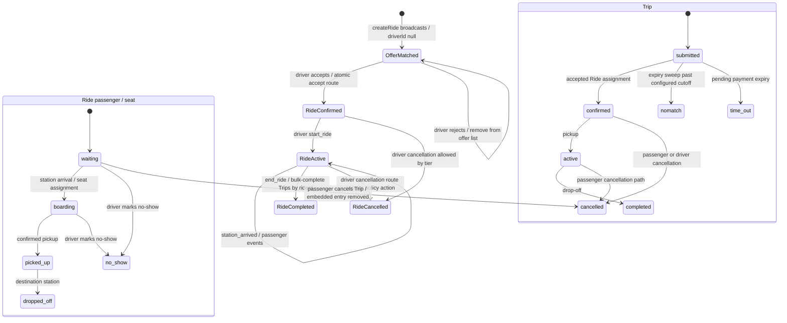

# Driver Action Center Audit

Scope: the driver ride detail/action surface, the separate pre-assignment ride-offer surface, and the services/routes that change those rides and their Trips. Repository state reviewed on branch `test/live-plus-latest`. All time references below use the implementation's configured/default values; settings may override some values.

## Files Map

| Path | Role | One-line purpose |
|---|---|---|
| `src/app/my-trips/[id]/page.tsx:154-194,230-251,642` | Driver ride detail entry | Authenticates, loads the trip/ride detail, and renders the shared seat map. |
| `src/components/trips/DriverRideInteractiveClient.tsx:121-141,383-652,827` | Action Center client | Renders and submits start, station, passenger, and ride-close actions. |
| `src/components/trips/VehicleSeatMap.tsx:27-110,146-205,350-390,470-555` | Seat visualization | Maps embedded Ride passenger statuses to seat colors and renders a legend. |
| `src/app/ride-requests/page.tsx:40-62` | Driver offer list | Provides the separate ride-offer list/empty state; offer-card controls are in `RideOfferCard.tsx:53-60`. |
| `src/components/trips/RideOfferCard.tsx:53-60` | Offer card | Calls the accept/reject endpoint and displays request errors. |
| `src/app/api/driver/rides/[id]/accept/route.ts:9-36` | Accept API | Atomically assigns an offered Ride to a driver and updates linked Trips. |
| `src/app/api/driver/rides/[id]/reject/route.ts:7-34` | Reject API | Removes the driver from an offer and records rejection state/logs. |
| `src/app/api/actions/ride/[rideId]/route.ts:269-485,505-596,598-840,1029-1085` | Action Center API | Computes the next action, records driver actions, changes Ride/passenger/Trip state, and completes rides. |
| `src/app/api/ride/[id]/route.ts:11-75` | Legacy Ride API | Exposes Ride GET/PATCH and cancellation DELETE; DELETE dispatches between driver and generic cancellation. |
| `src/lib/services/rideService.ts:135-268,502-524,728-735,905-1000,1019-1125` | Ride service | Creates/offers rides, reads driver rides, and implements cancellation and driver penalties. |
| `src/lib/services/rideMatching.ts:38+` | Matching service | Determines candidate drivers used when Ride offers are created. Exact scheduling call site for a D-1 17:00–19:00 batch: **NOT FOUND**. |
| `src/lib/cancellationPolicy.ts:25-35,90-116,130-176` | Driver policy/time rules | Defines reserve/cutoff defaults, availability lock helper, Cairo-time cancellation tiers, and nomatch filter. |
| `src/lib/passengerCancellationPolicy.ts:48-99,146-164,170-192` | Passenger policy | Selects passenger cancellation/refund tiers and computes refund/retained amounts. |
| `src/app/api/trips/[id]/cancel/route.ts:441-482,507-530` | Passenger cancellation API | Marks a Trip cancelled, records refund state, and removes its passenger entry from a Ride. |
| `src/lib/requestGroupCancellation.ts:63-92,121-194` | Multi-day cancellation service | Loads a Request and its children and performs group/day cancellation operations. |
| `src/app/api/trips/expire/route.ts:45-114` | Expiry/nomatch route | Expires pending Requests/Trips and marks eligible submitted Trips nomatch after cutoff. Scheduler invocation: **NOT FOUND** in the reviewed source. |
| `src/models/Ride.ts:28-49,120-176` | Ride model | Defines seat/passenger state, vehicle passenger count, and Ride lifecycle statuses. |
| `src/models/Trip.ts:92-99,124-136,217-250` | Trip model | Defines Request linkage, Trip status/payment fields, and Ride linkage. |
| `src/models/Request.ts:41-58` | Request model | Defines Request payment/status values, including timeout states. |
| `src/models/Wallet.ts:1-40` | Wallet model | Persists driver wallet balance/status and model constraints. |
| `src/models/AdminSettings.ts:1-33` | Settings model | Defines configurable cancellation-tier actions and windows. |
| `src/models/Log.ts:11-80` | Action log model | Persists Ride/Trip action and passenger event labels, including `no_show`. |
| `src/lib/config/featureFlags.ts:1-4` | Feature flag | Enables multi-day Request behavior only when `MULTI_DAY_REQUESTS_ENABLED` is `"true"`. |
| `src/app/globals.css:1493-1512` | Shared semantic colors | Defines semantic danger/success/info tokens; these are not the seat-map palette. |
| `tests/sharedRideStepper.test.mjs`, `tests/standaloneTripCancellation.test.mjs`, `tests/requestGroupCancellation.test.mjs`, `tests/availability.test.mjs`, `tests/walletReserveWithdrawal.test.mjs` (test line numbers: **NOT FOUND**) | Related tests | Cover adjacent helpers/flows; direct Action Center component/API, seat-color, driver-tier, and no-show completion tests: **NOT FOUND**. |
| `ACTION_CENTER.md`, `ACTION_CENTER_SUMMARY.md` (line numbers: **NOT FOUND**) | Existing documentation | Describe Action Center behavior; `ACTION_CENTER.md` documents a `/next` child path that does not match the implemented `[rideId]` route. |

## Scenario Matrix

| Scenario | Trigger | Who/what sets it (file:line) | What the driver sees (text, buttons) | Available actions | API called | DB fields changed | Side effects | Edge cases / conditions |
|---|---|---|---|---|---|---|---|---|
| New ride offer / pending unconfirmed ride | `createRide` finds eligible drivers; Ride is broadcast without an assigned driver. | `rideService.ts:135-268`; Ride broadcast fields in `Ride.ts:160-176`. | Offer card with ride details and accept/reject controls (`RideOfferCard.tsx:53-60`; `ride-requests/page.tsx`). | Accept or reject. | `POST /api/driver/rides/[id]/accept` or `/reject`. | Accept sets Ride `driverId`, `assignedDriver`, status `confirmed`, clears offer list; updates linked Trip driver/status (`accept/route.ts:19-31`). Reject updates offered/rejected driver bookkeeping (`reject/route.ts:16-34`). | Offer notifications are sent when `createRide` broadcasts (`rideService.ts:252-258`); accept/reject write logs (`accept/route.ts:7-36`, `reject/route.ts:5-34`). | Broadcast Ride status is still `matched`, with `driverId: null`; it is not a confirmed assignment (`Ride.ts:160-176`). |
| Accept offer | Driver selects Accept on an available offer. | Atomic conditional update (`accept/route.ts:19-31`). | Offer card reports an error if the response is not OK; on success it refreshes (`RideOfferCard.tsx:53-60`). | Accept once; a second/stale accept fails the match condition. | `POST /api/driver/rides/[id]/accept`. | Ride becomes `confirmed`; linked Trips become `confirmed` and receive driver assignment (`accept/route.ts:19-31`). | Driver-accepted log entries (`accept/route.ts:31-36`). | Requires authenticated driver and matching offer/eligibility (`accept/route.ts:9-21`). |
| Reject offer | Driver selects Reject. | Conditional update of an offered, unassigned, `matched` Ride (`reject/route.ts:16-34`). | Offer-card error/success refresh behavior (`RideOfferCard.tsx:53-60`). | Reject. | `POST /api/driver/rides/[id]/reject`. | Driver removed from offers and recorded as rejected; Ride may be flagged for manual assignment (`reject/route.ts:16-34`). | Rejection is logged for passenger/Trip records (`reject/route.ts:31-34`). | Does not cancel the Ride or passenger Trip. |
| Ride assigned / upcoming | Accepted offer or Ride already has driver and status `confirmed`. | Accept route (`accept/route.ts:19-31`); model enum (`Ride.ts:160-176`). | Detail page shows trip status and driver controls (`my-trips/[id]/page.tsx:197-232`; client controls in `DriverRideInteractiveClient.tsx:383-652`). | Start; station arrival/passenger state actions; close when route stops are handled. | `POST /api/actions/ride/[rideId]`. | Ride and related Trip/log fields vary by action (`actions/ride/[rideId]/route.ts:567-596,598-840,1029-1048`). | Driver ride-start/station/completion logs; completion can notify admins (`actions/ride/[rideId]/route.ts:770-825,1030-1050`). | Ride enum is `matched`, `confirmed`, `active`, `completed`, `cancelled`; `upcoming` is a UI/domain label, not a Ride enum member (`Ride.ts:160-176`). |
| Start ride | Driver presses Start Ride. | UI sends `start_ride` (`DriverRideInteractiveClient.tsx:405-418`); API handles it (`actions/ride/[rideId]/route.ts:567-596`). | Start Ride / loading label; local state changes after request (`DriverRideInteractiveClient.tsx:405-418`). | Start ride. | `POST /api/actions/ride/[rideId]`, action `start_ride`. | Ride is set `active`; action is logged (`actions/ride/[rideId]/route.ts:568-596`). | Trips are started/logged through action helpers. | The UI handler does not check `res.ok` before locally setting `rideStarted` (`DriverRideInteractiveClient.tsx:405-418`). The API case has no explicit current-status guard at the action branch (`actions/ride/[rideId]/route.ts:567-596`). |
| Arrive at station / fill or empty a seat | Driver confirms arrival and marks passenger arrived, picked up, dropped off, or no-show. | UI station selections (`DriverRideInteractiveClient.tsx:131,446-460,1301-1316`); API station action (`actions/ride/[rideId]/route.ts:598-840`). | Station/manifest, passenger state controls, and seat map (`DriverRideInteractiveClient.tsx:827,1060-1084,1212-1316`; `VehicleSeatMap.tsx:146-205`). | Confirm arrival; assign seat/board; alight; mark no-show. | `POST /api/actions/ride/[rideId]`, action `station_arrived`. | Embedded Ride passenger status/seat is updated; successful pickup sets the Trip `active`, successful drop-off sets Trip `completed` (`actions/ride/[rideId]/route.ts:598-840`). | Logs each passenger/station transition; completion path can notify admins (`actions/ride/[rideId]/route.ts:730-825`). | One RidePassenger entry is used for a Trip; if a Trip has `numberOfPassengers > 1`, the initial count can exceed the one-per-Trip seat assignment exposed by the Action Center (`Ride.ts:34`, `Trip.ts:203-204`, `actions/ride/[rideId]/route.ts:598-840`). |
| Passenger no-show | Driver chooses No-show at a station. | Client marks selection (`DriverRideInteractiveClient.tsx:1301-1316`); API changes embedded Ride passenger status (`actions/ride/[rideId]/route.ts:598-840`). | No-show label and red selection styling (`DriverRideInteractiveClient.tsx:1182-1212,1301-1316`). | Continue station flow / end ride. | `POST /api/actions/ride/[rideId]`, `station_arrived`. | Embedded Ride passenger becomes `no_show`; the no-show branch does not update the associated Trip status (`actions/ride/[rideId]/route.ts:598-840`). | Ride action is logged. | At ride end, all Trips with that `rideId` are bulk-marked completed, including a no-show Trip (`actions/ride/[rideId]/route.ts:1029-1048`). |
| Passenger cancels a matched Trip | Passenger submits cancellation. | Passenger route sets Trip `cancelled` and removes its Ride passenger entry (`trips/[id]/cancel/route.ts:441-482,507-530`). | Driver manifest filters cancelled/no-show entries (`DriverRideInteractiveClient.tsx:287-295`). | Driver has no cancellation control for the passenger; continue the Ride. | `POST /api/trips/[id]/cancel` (passenger-facing). | Trip becomes `cancelled`, refund metadata/status is set; Ride passenger list is filtered. The route does not clear `Trip.rideId` (`trips/[id]/cancel/route.ts:441-482,507-530`; `Trip.ts:245-250`). | Refund amount goes to pending approval when positive (`passengerCancellationPolicy.ts:146-164`; cancellation route `:476-482`). | Ride end bulk-updates every still-linked Trip to `completed`, so a passenger-cancelled Trip can be overwritten (`actions/ride/[rideId]/route.ts:1047-1048`). |
| Driver cancels before lock | Driver calls Ride cancellation before D-1 17:00 Cairo time. | Policy default `00:00–17:00` is free (`cancellationPolicy.ts:25-35,130-176`); driver service evaluates and cancels (`rideService.ts:1019-1125`). | No driver-cancel button was found in the Action Center component; cancellation entry is the Ride DELETE API. | Cancel through API; no in-UI cancel action found. | `DELETE /api/ride/[id]`. | Ride `cancelled`; linked Trips are unassigned/reset (`rideService.ts:1093-1125`). | No percentage penalty before cutoff; logs/notifications: cancellation-specific passenger notification **NOT FOUND** in this path. | D-1 is derived using configured Cairo-time rules (`cancellationPolicy.ts:130-176`). |
| Driver cancels during D-1 17:00–19:00 lock window | Driver attempts cancellation while cancellation action is blocked. | Default tier `blocked` (`cancellationPolicy.ts:25-35,130-176`); service rejects blocked action (`rideService.ts:1030-1088`). | No in-Action-Center cancel control found; API error is the visible route response. | Cancellation is denied by policy. | `DELETE /api/ride/[id]`. | No cancellation update when blocked. | No penalty charged. | This is distinct from the availability lock helper at D-1 17:00 (`cancellationPolicy.ts:102-128`); calls to `canModifyAvailability` elsewhere in `src`: **NOT FOUND**. |
| Driver cancels after lock: 25% / 50% / 110% tiers | Cancellation after the lock and during the configured tier. | Defaults: 19:00–21:00 = 25%, 21:00–23:00 = 50%, 23:00 onward = 110% (`cancellationPolicy.ts:25-35,130-176`). | No cancellation control in Action Center found; API response/error only. | Cancel through API if wallet/policy permits. | `DELETE /api/ride/[id]`. | Ride cancelled; linked Trips unassigned/reset; cancellation metadata saved (`rideService.ts:1093-1125`). | Penalty is calculated from Ride price and debited directly from wallet balance; reserve is not subtracted from this penalty calculation (`rideService.ts:1030-1088,1111-1125`). | Admin settings can override tier values. The 200 EGP default is a withdrawal reserve, not a protected cancellation balance (`cancellationPolicy.ts:25-35`; `walletReserveWithdrawal.test.mjs`). |
| Insufficient wallet / reserve | Penalty would take wallet balance below zero, or below the 200 EGP withdrawal reserve. | Penalty debit is in driver cancellation service (`rideService.ts:1030-1088,1111-1125`); withdrawal reserve default is `200` (`cancellationPolicy.ts:25-35`). | No Action Center-specific precheck or warning found. API error response only (`api/ride/[id]/route.ts:71-74`). | Cancellation may fail if wallet model validation rejects negative balance. | `DELETE /api/ride/[id]`. | A successful penalty reduces `balanceEgp`; a failed transaction should not persist partial cancellation (`rideService.ts:1019-1125`; Wallet model constraints `Wallet.ts:1-40`). | Reserve can be consumed by cancellation; insufficient balance failure/rollback behavior is not covered by a driver penalty test: **NOT FOUND**. | `walletReserveWithdrawal.test.mjs` covers withdrawal reserve behavior, not penalty deductions. |
| Ride starting / in progress | Start action accepted; station actions progress. | Action route sets active and station pickup/dropoff updates Trips (`actions/ride/[rideId]/route.ts:568-596,598-840`). | In-progress state, current route/station, passenger manifest and seats (`DriverRideInteractiveClient.tsx:383-652,827+`). | Station-arrived actions; no-show; close after stops. | `POST /api/actions/ride/[rideId]`. | Ride remains `active`; Trips move active/completed as passenger events occur (`actions/ride/[rideId]/route.ts:730-825`). | Logs and possible admin completion notification. | UI labels can diverge from database status because local optimistic state is updated without checking response status for start/end (`DriverRideInteractiveClient.tsx:405-418,close handler around :520-560`). |
| Ride completed | Driver closes after station processing. | API end branch (`actions/ride/[rideId]/route.ts:1029-1085`). | Close Ride / closing indicator; completion view after local update (`DriverRideInteractiveClient.tsx:520-560,1346-1363`). | End ride. | `POST /api/actions/ride/[rideId]`, `end_ride`. | Ride status `completed`; `Trip.updateMany({ rideId }, { status: "completed" })` (`actions/ride/[rideId]/route.ts:1034-1048`). | Logs completion and sends admin notifications for completed paid Trips (`actions/ride/[rideId]/route.ts:1030-1050`). | Bulk update ignores each Trip's prior state, causing no-show/cancelled Trip status overwrite. UI also does not check `res.ok` before local completion (`DriverRideInteractiveClient.tsx:520-560`). |
| Expired payment / timed out | Pending Request/Trip exceeds expiry age. | Expiry route updates Request and child Trips to `time_out`/`expired` (`trips/expire/route.ts:45-85`). | Driver Action Center display for `time_out`/`expired`: **NOT FOUND**. | No driver action is exposed. | `POST /api/trips/expire` or scheduled invocation: invocation **NOT FOUND** in reviewed source. | Request/Trip status and payment status updated; promo reservation released (`trips/expire/route.ts:64-85`). | No-match sweep logs Trip transitions. | Pending Request/Trip expiry and standalone expiry use separate helpers (`trips/expire/route.ts:45-89`). |
| Submitted Trip not matched / nomatch | Submitted Trip passes configured cutoff without a Ride. | Expiry route selects submitted Trips and marks `nomatch` (`trips/expire/route.ts:87-103`). | Driver Action Center state for nomatch: **NOT FOUND**; this is a passenger Trip status, not Ride status. | No driver action. | Expiry route, scheduler invocation **NOT FOUND**. | Trip status `nomatch`; log created (`trips/expire/route.ts:90-103`). | Passenger-facing nomatch notification/log path. | Default cutoff is 23:00; no D-1 17:00–19:00 matching job/call site was found. Offers are sent when `createRide` runs (`cancellationPolicy.ts:25-35,90-100`; `rideService.ts:135-268`). |
| Multi-day Request / grouped children | Feature flag enabled and Request has child Trips. | Flag gate (`featureFlags.ts:1-4`); Trip `requestId` (`Trip.ts:92-99`); cancellation group service (`requestGroupCancellation.ts:63-194`). | Action Center is a Ride manifest/Trip view; Request/group-level date/status UI in this component: **NOT FOUND** (`DriverRideInteractiveClient.tsx:827+`). | Driver acts on the Ride/Trip passenger manifest; group cancellation is passenger-side. | Ride action API for a child Ride; passenger group-cancel service for Request-level cancellation. | Per-child Trip linkage/status and parent Request status can change independently (`requestGroupCancellation.ts:121-194`; `Trip.ts:217-250`). | Passenger cancellation/refund behavior may operate per child or remaining Request children. | Ride passenger data holds `tripId`, not Request/group display state (`Ride.ts:28-49`). |
| Empty state / loading / error | No eligible offers, page load/action pending, or API failure. | Offer list and client loading/error state (`ride-requests/page.tsx`; `RideOfferCard.tsx:53-60`; `DriverRideInteractiveClient.tsx:141`). | Offer-card error message is shown on rejected accept/reject (`RideOfferCard.tsx:53-60`); action buttons show loading labels (`DriverRideInteractiveClient.tsx:141,1346-1363`). Empty-state exact text and dedicated error boundary: **NOT FOUND** in inspected Action Center surfaces. | Retry offer action / continue after loading; no start/end response error is surfaced reliably. | Offer accept/reject endpoints; action endpoint for ride operations. | None on page load; action API writes per prior rows. | Start/end catch errors to console but optimistically update local UI (`DriverRideInteractiveClient.tsx:405-418,520-560`). | Station confirmation checks response status; start/end do not (`DriverRideInteractiveClient.tsx:405-418` and station handler in `:460-500`). |

### Matching and lock findings

- The configured availability lock is 17:00 on the day before the availability date; helper definition is `cancellationPolicy.ts:102-128`. Calls to that helper in `src`: **NOT FOUND**.
- Driver cancellation windows are independently defined in `cancellationPolicy.ts:25-35,130-176`. In particular, the 17:00–19:00 driver-cancellation tier is blocked, not a matching window.
- A scheduled D-1 17:00–19:00 passenger-to-driver matching job, and a filter limiting that job to `submitted`/`upcoming` Trips, are **NOT FOUND**. The located offer creation path runs when `createRide` is invoked (`rideService.ts:135-268`); the located cutoff sweep only marks `submitted` Trips `nomatch` (`trips/expire/route.ts:87-103`).

## Seat Colors

| Seat state | Meaning | Color (class + hex) | Defined in | Rendered in | Condition |
|---|---|---|---|---|---|
| Empty / no eligible occupied passenger | Seat available/default | White `#FFFFFF`/no state fill, grey border; legend swatch uses `#F8FAFC` | `VehicleSeatMap.tsx:150-203,350-390,470-555` | Same component, used in driver and passenger trip detail | No passenger matches a non-empty seat-state rule; `no_show`/`cancelled` are excluded/fall through to grey (`VehicleSeatMap.tsx:181-203`). |
| Boarding | Passenger is boarding | Green `#27AE60`/green state | `VehicleSeatMap.tsx:181-188,350-390` | `VehicleSeatMap.tsx:350-390` | Embedded Ride passenger status is `boarding`. |
| Onboard / picked up | Passenger has boarded | Blue `#2F80ED`/blue state | `VehicleSeatMap.tsx:181-188,350-390` | `VehicleSeatMap.tsx:350-390` | Embedded passenger status is `picked_up`/onboard. |
| Alighted / dropped off | Passenger has left the vehicle | Red `#E74C3C`/red state | `VehicleSeatMap.tsx:187-203,350-390` | `VehicleSeatMap.tsx:350-390` | Embedded passenger status is `dropped_off`. |
| No-show / cancelled | Not occupying a seat | No dedicated seat color; falls through to empty grey/white | `VehicleSeatMap.tsx:181-203`; driver selection uses red `#E74C3C` in `DriverRideInteractiveClient.tsx:1301-1316` | Seat map in `VehicleSeatMap.tsx:350-390`; selection control in driver client | `no_show` or `cancelled` is filtered from seat occupancy (`DriverRideInteractiveClient.tsx:287-295`). |
| Selected no-show control | Pending UI selection, not a seat state | Red border `#E74C3C`, pale red background `#FFEBEE`, text `#C0392B` | `DriverRideInteractiveClient.tsx:1301-1316` | Same lines | Driver selects no-show for the passenger. |

- The same `VehicleSeatMap` component is used by driver and passenger trip-detail surfaces (`my-trips/[id]/page.tsx:24,642`; `DriverRideInteractiveClient.tsx:20,827`). Admin seat-map use: **NOT FOUND**.
- Seat colors and legend swatches are hardcoded in the component rather than shared state tokens (`VehicleSeatMap.tsx:181-203,350-390,470-555`). Global semantic colors differ: `--color-danger #e74c3c`, `--color-success #27ae60`, and `--color-info #2563eb` (`globals.css:1493-1512`); the seat blue is `#2F80ED`.
- The empty legend swatch is `#F8FAFC`, while the seat renderer's empty state is white/default; the legend also contains an “Onboard / Alighting (Red)” description inconsistent with onboard blue and alighted red (`VehicleSeatMap.tsx:470-555`).
- No dark-mode-specific seat palette was found; seat colors are inline hardcoded light colors. Text labels and a legend provide non-color cues, but no contrast measurements or colorblind-safe validation were found. Seat statuses absent from the rules fall back to empty/grey (`VehicleSeatMap.tsx:181-203`).

## State Diagram

Transition sources: offer assignment/rejection (`src/app/api/driver/rides/[id]/accept/route.ts:19-31`, `reject/route.ts:16-34`); Ride transitions and passenger station actions (`src/app/api/actions/ride/[rideId]/route.ts:567-596,598-840,1029-1048`); Ride cancellation (`src/lib/services/rideService.ts:1019-1125`); Trip passenger cancellation (`src/app/api/trips/[id]/cancel/route.ts:441-530`); timeout and nomatch (`src/app/api/trips/expire/route.ts:45-103`). The diagram captures implemented transitions relevant to this Action Center, not every payment/admin transition.

## Change History

Reviewed history follows the current branch, `test/live-plus-latest`; the hashes below are commits in that branch's history. The chronology focuses on commits touching the Action Center, seat visualization, ride service, availability, cancellation, or expiry. Where the retained evidence does not establish a precise code delta, that detail is marked **NOT FOUND** rather than inferred.

| Date | Commit | Branch reviewed | Change and audit relevance |
|---|---|---|---|
| 2026-07-21 | `5b79b47d2d8e8ae71bc2c59c889a1301e99edd3f` | `test/live-plus-latest` | Ride/match merge; exact Action Center behavior delta: **NOT FOUND**. |
| 2026-07-22 | `ee849ce77c742ad97bbd1bdab23d10b26a96c5b1`, `54378a41f5eb152199253c44eec70260c3646736`, `57254dfd96e23e6d33307047ff2cdacb54b57961`, `4845013f29c150f1e641162f6518e0f79d2ca092` | `test/live-plus-latest` | Merge commits touching ride matching/service history; exact Action Center behavior deltas: **NOT FOUND**. |
| 2026-07-25 | `6dec5460790b59b2c16a7a929c7f1fdbbd91acfb` | `test/live-plus-latest` | Added ride varieties per commit subject; seat/action behavior delta: **NOT FOUND**. |
| 2026-07-25 | `ae10b2eae7bab4e586dc49a444b748fed4321934` | `test/live-plus-latest` | Ride API fix per commit subject; exact Action Center behavior delta: **NOT FOUND**. |
| 2026-07-27 | `aa2f0856b04f2b95379066e9f2fe25fff87fc7f2` | `test/live-plus-latest` | Introduced the seat map and trip-detail seat visualization. |
| 2026-07-27 | `e402f2338478ccb840cc7d95b775a3f54843fddc` | `test/live-plus-latest` | Edited match data per commit subject; exact Action Center transition delta: **NOT FOUND**. |
| 2026-07-28 | `9bd96a6963d5a0970f62c0860650ac9d4957a79a` | `test/live-plus-latest` | Edited match data per commit subject; exact Action Center transition delta: **NOT FOUND**. |
| 2026-07-28 | `33c3ccfa780c76b7a1cd26ea255a6f1f7b556dc8` | `test/live-plus-latest` | MongoDB deprecation fixes per commit subject; Action Center behavior delta: **NOT FOUND**. |
| 2026-07-31 | `91fd08c2dafc52f8a668e29a91ca038f3e864c06` | `test/live-plus-latest` | Match-data fixes per commit subject; exact Action Center behavior delta: **NOT FOUND**. |
| 2026-08-01 | `0cb1a8b3a19bbab2d75b4e22ec98840ba8b8fccd` | `test/live-plus-latest` | Seat visualization was extended/refined; initial palette differs from the later green/blue/red state palette. |
| 2026-08-02 | `c2c279bd15121da3241047d45471bcae1f7661c7` | `test/live-plus-latest` | Updated OSM/trips per commit subject; exact seat/action delta: **NOT FOUND**. |
| 2026-08-03 | `6a8781d0ceded0d64fb75bd172c768e210ea3b41` | `test/live-plus-latest` | Merge touching seat and Action Center files; exact transition delta: **NOT FOUND**. |
| 2026-08-05 | `a1fbd26621f0e8abeb1aad369ef3e5de19ec0ddb` | `test/live-plus-latest` | Large seat/driver interaction change; affects interaction and passenger-state rendering. |
| 2026-08-08 | `3fa15c54b3c5a20decde47a0ead2ee2373f1f6a8` | `test/live-plus-latest` | Localization and seat-state palette changes; current boarding-green/onboard-blue/alighted-red mapping appears in later code. |
| 2026-08-11 | `4beb1047ee6697e29d99aaaa7b856c77fd52a07d` | `test/live-plus-latest` | Promo/referral change touched the Action API file; exact Action Center behavior delta: **NOT FOUND**. |
| 2026-08-12 | `10d5037d839903feccf987a6674f4616ad58e5bd` | `test/live-plus-latest` | Driver UI comment-fix commit per subject; exact state/behavior delta: **NOT FOUND**. |
| 2026-08-15 | `5f4258f7529e8e114841aeb9ad5a5a1e8e98291b` | `test/live-plus-latest` | Ride service update; exact Action Center behavior delta: **NOT FOUND**. |
| 2026-08-15 | `861e1597f69b97a8e40e035147ac86ce0b67d88a` | `test/live-plus-latest` | Referral-code change touched the Action API file; exact Action Center behavior delta: **NOT FOUND**. |
| 2026-08-16 | `5e63e6ffd8f7460fc8ffbb6ce1989a6908121ff9` | `test/live-plus-latest` | Changed Ride/seat state behavior; later UI/API state handling reflects this refactor. |
| 2026-08-16 | `1668478c1b178487c8ad3149a1603c1c4cc6a04d` | `test/live-plus-latest` | Driver UI test-error fix per commit subject; exact state/behavior delta: **NOT FOUND**. |
| 2026-08-19 | `27d7af8d5e31f2d874964032bbfe83f753d004da` | `test/live-plus-latest` | Merge touching Ride service; exact Action Center delta: **NOT FOUND**. |
| 2026-08-19 | `1c1cfd462ebf3ed3130c3d677f0701234a764444` | `test/live-plus-latest` | Ride service change per commit subject; exact behavior delta: **NOT FOUND**. |
| 2026-08-19 | `d2651ddefbdb1fc53c601d5c74de825b53e2fd85` | `test/live-plus-latest` | Ride-fix commit; exact state/behavior delta: **NOT FOUND**. |
| 2026-08-19 | `65b8f32a5d45bc6f7825ee41809ee446fc5ec562` | `test/live-plus-latest` | Changed station/seat and Action Center behavior. |
| 2026-08-22 | `d64996e661568bc2ff8c56cff2a46739b39f1d32` | `test/live-plus-latest` | Refactored Action Center route/seat behavior; current route contract remains `/api/actions/ride/[rideId]`, not a `/next` child endpoint. |
| 2026-08-23 | `fc856971491b6a1c1be23979da7112c7452d9407` | `test/live-plus-latest` | Ride-service bug-fix commit; exact cancellation/Action Center delta: **NOT FOUND**. |
| 2026-08-29 | `97d0e1b1a06dd0bce2f1add8ba03f2a01fd23e46` | `test/live-plus-latest` | Added driver cancellation tiers and wallet penalty logic; introduces the reserve-vs-penalty concern documented below. |
| 2026-09-08 | `e4b65b4fe94a6d605b73b691f821647d82af7d02` | `test/live-plus-latest` | Added/changed nomatch cutoff behavior in the expiry path. |
| 2026-09-09 | `7a7ed3b847d8358aefa7e11d91b4f99d368e08af` | `test/live-plus-latest` | Availability change per commit subject; exact enforcement delta: **NOT FOUND**. |
| 2026-09-12 | `253183aaf951c45a18bc0cbd4dec4d818539b4f6` | `test/live-plus-latest` | Ride service update; exact Action Center behavior delta: **NOT FOUND**. |
| 2026-09-14 | `f812e9a03c87dedad950555f0eed274d873839b5` | `test/live-plus-latest` | Station fix per commit subject; exact passenger/seat transition delta: **NOT FOUND**. |
| 2026-09-30 | `f1000d006fa260c1adb8a59fff4d7466eecadc6a` | `test/live-plus-latest` | Added admin notifications on trip completion; completion still bulk-updates Trips by `rideId`. |
| 2026-10-13 | `6f8bdc715f159cb9106acc75293bbda4d803b956` | `test/live-plus-latest` | Trip-detail spacing/visual-only change; no behavior change identified. |

**History evidence limitation:** `git log --follow` was captured for the seat map, driver client, Action API, and Ride service. Exact behavior deltas are marked **NOT FOUND** where the retained evidence includes a commit subject but not a verified patch-level change. The table describes the relevant commits in those histories, not every commit affecting every dependency.

## Findings

### High

1. **Unauthenticated callers can use the generic Ride cancellation path.** `DELETE /api/ride/[id]` only selects driver cancellation when the session role is `driver`; all other callers, including no session, fall through to `cancelRide` (`src/app/api/ride/[id]/route.ts:55-67`). This allows an unauthenticated caller to invoke the generic Ride cancellation service (`src/lib/services/rideService.ts:905-1000`). Suggested fix: require an authorized role and ownership/administrative permission before either cancellation path.
2. **A cancelled driver Ride can be started again from the Action Center.** Driver cancellation sets Ride status to `cancelled` but retains its `driverId` (`src/lib/services/rideService.ts:1093-1125`). The detail loader can still find a Ride for its assigned driver (`src/lib/services/rideService.ts:502-524`), and the UI start condition does not exclude `cancelled` (`src/components/trips/DriverRideInteractiveClient.tsx:383-418`). The `start_ride` action has no current-status guard and sets the Ride active (`src/app/api/actions/ride/[rideId]/route.ts:567-596`). Suggested fix: hide controls for terminal states and enforce allowed source statuses in the API.
3. **Ride completion overwrites no-show and passenger-cancelled Trip states.** `end_ride` updates every Trip matching `rideId` to `completed` (`src/app/api/actions/ride/[rideId]/route.ts:1029-1048`). The no-show branch only changes the embedded Ride passenger and leaves the Trip unchanged (`:598-840`); passenger cancellation removes the embedded passenger but does not clear the Trip's `rideId` (`src/app/api/trips/[id]/cancel/route.ts:441-482,507-530`; `src/models/Trip.ts:245-250`). Suggested fix: complete only eligible active Trips and clear Ride linkage on cancellation/no-show as appropriate.
4. **Penalty deduction ignores the non-withdrawable reserve.** The default reserve is 200 EGP (`src/lib/cancellationPolicy.ts:25-35`), but driver cancellation computes and debits the penalty directly from `balanceEgp` (`src/lib/services/rideService.ts:1030-1088,1111-1125`). Therefore the reserve can be consumed by a cancellation; when balance is insufficient, the wallet constraint may reject the transaction (`src/models/Wallet.ts:1-40`). Suggested fix: define whether reserve is protected from penalties; enforce that rule in the transactional penalty calculation and add tier/insufficient-balance tests.

### Medium

5. **Start/end UI treats failed API responses as success.** Start and close handlers do not check `res.ok` before updating local state (`src/components/trips/DriverRideInteractiveClient.tsx:405-418` and close handler around `:520-560`). This can show a started/completed Ride while the server rejected the action. Suggested fix: validate response status/body before applying the local transition and display the API error.
6. **Required D-1 matching window and status filter are not present in reviewed source.** The stated 17:00–19:00 availability/cancellation windows exist (`src/lib/cancellationPolicy.ts:25-35,102-128`), but a D-1 batch matcher that selects only submitted/upcoming Trips is **NOT FOUND**. Located Ride offers are created when `createRide` runs (`src/lib/services/rideService.ts:135-268`); expiry only marks `submitted` Trips `nomatch` after cutoff (`src/app/api/trips/expire/route.ts:87-103`). Suggested fix: identify the external scheduler or implement/document the intended matcher and its idempotent time/status guards.
7. **Availability lock helper has no discovered enforcement call site.** `canModifyAvailability` encodes the D-1 17:00 lock (`src/lib/cancellationPolicy.ts:102-128`), but its call sites in `src`: **NOT FOUND**. Suggested fix: apply the helper in the server-side create/update/delete availability endpoints and test boundary times.
8. **Multiple passengers on one Trip may not map to multiple Action Center seats.** Trip permits `numberOfPassengers > 1` (`src/models/Trip.ts:203-204`) and Ride tracks passenger count (`src/models/Ride.ts:34`), but station seat assignment operates on a Ride passenger entry/Trip (`src/app/api/actions/ride/[rideId]/route.ts:598-840`). Suggested fix: make the seat model represent each passenger or explicitly constrain a RidePassenger to one occupied seat.
9. **Multi-day Request grouping is invisible in the Action Center.** The flag gates multi-day behavior (`src/lib/config/featureFlags.ts:1-4`) and child Trips carry `requestId` (`src/models/Trip.ts:92-99`), while the Action Center manifest is Trip/Ride-passenger based (`src/models/Ride.ts:28-49`; `DriverRideInteractiveClient.tsx:827+`). Suggested fix: expose Request/date-group context where drivers need to understand related child Trips; ensure cancellation effects on one child are reflected in the manifest.

### Low

10. **Seat color definitions are duplicated and not fully consistent.** State fills and legend colors are hardcoded in the seat map (`src/components/trips/VehicleSeatMap.tsx:181-203,350-390,470-555`), while global semantic tokens use a different info blue (`src/app/globals.css:1493-1512`). Empty legend swatch and actual default seat rendering differ, and the legend's onboard/alighting wording conflicts with the colors (`VehicleSeatMap.tsx:470-555`). Suggested fix: use shared state tokens and derive the legend from the same mapping used by the renderer.
11. **Potential stale Action Center documentation route.** `ACTION_CENTER.md` documents `/next`, while the implementation is the `[rideId]` route `src/app/api/actions/ride/[rideId]/route.ts:269-485`. The documentation line number was **NOT FOUND** in captured evidence. Suggested fix: update the existing document to the actual route after confirming whether `/next` was intentionally removed.
12. **Direct scenario test coverage is missing.** Direct tests for the Action Center API/UI, seat colors, driver cancellation tiers, and no-show-to-completion behavior: **NOT FOUND**. Related tests exist for shared ride stepping, standalone/request cancellation, availability, and wallet withdrawal reserve (test paths listed in Files Map). Suggested fix: add focused tests for transition guards, cancellation tier boundaries/rollback, seat mapping/legend, and no-show/cancelled Trip completion exclusion.

## Open Questions

- Is an external scheduler responsible for the D-1 17:00–19:00 matching run? Matching-job evidence in this repository: **NOT FOUND**.
- Is `reservedBalanceEgp` meant to remain protected from cancellation penalties, or is it only protected for withdrawal/payment reservations? The wallet invariant between `reservedBalanceEgp` and `balanceEgp` was removed; the intended policy is undecided.
- Should the driver portal expose a cancellation button for a confirmed Ride? No driver-facing cancel button was found in the Action Center.
- Should no-show Trips earn driver payment? They are deliberately not settled because the existing settlement helper only accepts completed Trips; a policy decision is pending.
- Should outstanding driver debt be repaid from sources other than Trip earnings?
- How should the Action Center display child Trips belonging to a multi-day Request?

## Resolution status

1. **Resolved** — unauthenticated Ride cancellation was fixed on `fix/action-center-blockers` (`2442285`, `fix: authorize ride API access`).
2. **Resolved** — terminal/cancelled Ride actions were guarded on `fix/action-center-blockers` (`a61e83d`, `fix: guard driver ride actions`).
3. **Resolved** — end-ride no longer overwrites no-show or other ineligible Trip states on `feat/no-show-trips` (`493d59f`, `feat: mark no-shows at ride end`).
4. **Partially resolved** — low-wallet penalties now create debt on `feat/driver-penalty-debt` (`a2d8cab`, `fix(wallet): apply cancellation penalties without blocking`); the reserve/invariant policy remains open.
5. **Resolved** — failed Action Center responses are handled on `fix/action-center-blockers` (`355ab5d`, `fix: surface ride action failures`).
6. **Still open** — the repository does not establish an external D-1 matching schedule; the matching endpoint guards do not prove a scheduled run.
7. **Still open** — availability lock enforcement has no discovered call site; rule implementation remains undecided.
8. **Resolved** — multi-seat allocation/boarding is covered on `feat/multi-seat-boarding` (`409d36c`, `test: cover multi-seat boarding fallbacks`).
9. **Still open** — multi-day Request grouping remains invisible in the driver Action Center.
10. **Resolved** — seat-map legend wording and swatches now use the renderer's state mapping on `chore/release-prep` (`9083b5a`, `fix(cleanup): align action center and vehicles`).
11. **Resolved** — Action Center documentation now names the implemented route and current action names on `chore/release-prep` (`9083b5a`).
12. **Partially resolved** — tests now cover action guards, multi-seat capacity, incident and no-show flows across `fix/action-center-blockers` and `feat/no-show-trips`; direct UI coverage and tests for every legacy Action Center scenario are still missing.

Additional open items: no driver-facing cancel button; no-show earnings remain unsettled pending a policy decision; debt repayment currently comes from Trip earnings; and the `reservedBalanceEgp`/`balanceEgp` invariant is no longer enforced.
